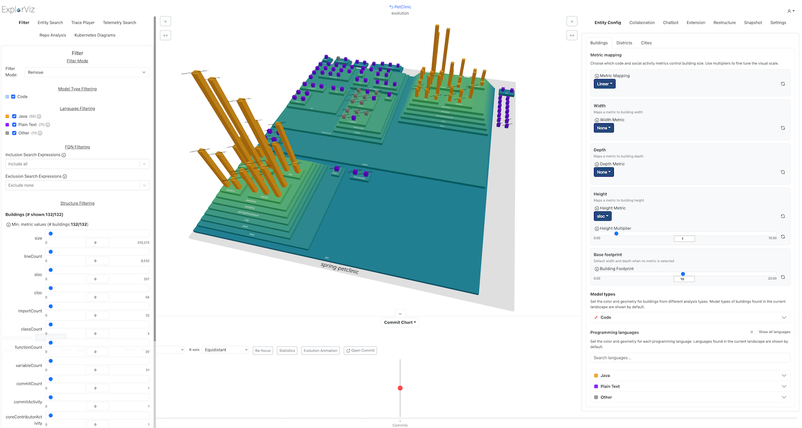
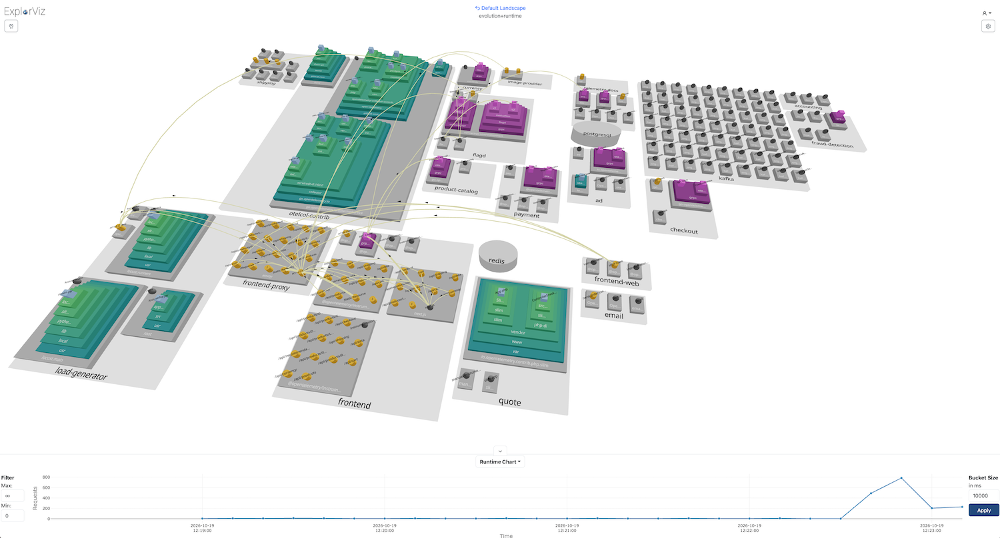

---
hide:
  - navigation
---

# Getting started

## 1) Start Full-Stack of ExplorViz

1\. Clone the [deployment](https://github.com/ExplorViz/deployment) repo and `cd` into the Docker directory.

```sh
git clone https://github.com/ExplorViz/deployment.git
cd deployment/docker/
```

2\. Use `docker compose` to start ExplorViz' software environment and its services. The frontend is served via nginx and by default runs on port `8080`. You can change ports and hostnames in the (hidden) `.env` file.

```sh
docker compose up --pull=always
```

3\. Open [http://localhost:8080](http://localhost:8080) in your web browser. You should see the frontend of ExplorViz with a list of software landscapes. Proceed with either of the following sections to visualize different aspects of software systems.

## 2a) Visualize Git Repositories (Static Analysis)

1\. In the list of software landscapes, add a new landscape via the `+` icon. Click on the :octicons-code-24: icon and insert a GitHub URL (e.g. `https://github.com/spring-projects/spring-petclinic.git`). Then click the `Run Analysis` button to start the static analysis.

2\. After the analysis has finished, the visualization of the analyzed software system should be opened.

<figure markdown>
{width="1500"}
<figcaption>Exemplary Visualization of the PetClinic Demo</figcaption>
</figure>

## 2b) Visualize OpenTelemetry Data (Dynamic Analysis)

1\. In this section, we visualize the OpenTelemetry data produced by the [OpenTelemetry Demo](https://github.com/open-telemetry/opentelemetry-demo).

2\. Select the `Default Landscape` in the frontend of ExplorViz.

3\. Start the Docker software stack of the OpenTelemetry demo:

```sh
cd deployment/docker/compose/otel-demo
docker compose up
```
4\. Ensure that the software stack is running and functional, the frontend of the OpenTelemetry demo should be running on [http://localhost:18080](http://localhost:18080).

5\. The OpenTelemetry data should be visualized in ExplorViz when selecting the `Default Landscape`. Select the `Runtime Chart` from the dropdown in the bottom bar.

<figure markdown>
{width="1500"}
<figcaption>Visualization of the OpenTelemetry Demo</figcaption>
</figure>

## 2c) Visualize a Running Java Application

In this section we explore how to visualize your desired application's runtime behavior. Therefore, we employ a dynamically analyzed Java example application.

### Start the target Java application

5\. `cd` into the example applications directory. We use the [Spring PetClinic](https://github.com/spring-projects/spring-petclinic) as an example for now.

```sh
cd deployment/example-applications/petclinic-demo/
```

6\. Open the hidden `.env` file. Normally, this is the instrumentation configuration file where you would paste your token's `value` and `secret`. Since we use the default token for this instruction, you don't need that.

7\. Use `docker compose` to start the PetClinic.

```sh
docker compose up --pull=always -d
```

### Explore the runtime behavior

1\. Open [http://localhost:18080](http://localhost:18080) (frontend of PetClinic) in your web browser and generate some load by clicking around.

2\. Open [http://localhost:8080](http://localhost:8080) (frontend of ExplorViz) in your web browser and click on "Default Landscape" to open the visualization of the Spring PetClinic's runtime behavior.

3\. The visualization is updated every ten seconds and shows the aggregated runtime behavior of the Spring PetClinic.

4\. Right click (on the white background) to access the context menu.

5\. In the top corners you can find buttons to open sidebars with additional settings and features.


## Alternative: Visualization Demo with Mocked Backend

Below you can find instructions that will set up a demo of ExplorViz' frontend component with exemplary data, i.e.,a mocked backend with previously recorded data from a target application.
This demo can be used to explore our visualization approach, but is not fully functional due to the mocked backend.
For the visualization demo, you can also [try out our hosted demo instance](https://demo.explorviz.uni-kiel.de):

1\. Clone the [deployment](https://github.com/ExplorViz/deployment) repo and `cd` into the directory of the frontend demo.

```sh
git clone https://github.com/ExplorViz/deployment.git
cd deployment/frontend-demo/
```

2\. Use `docker compose` to start the software stack. The frontend will run on port `8080`. You can change all ports in the (hidden) `.env` file.

```sh
docker compose up --pull=always -d
```

3\. Open [http://localhost:8080](http://localhost:8080) in your web browser (we recommend Google Chrome)

---
